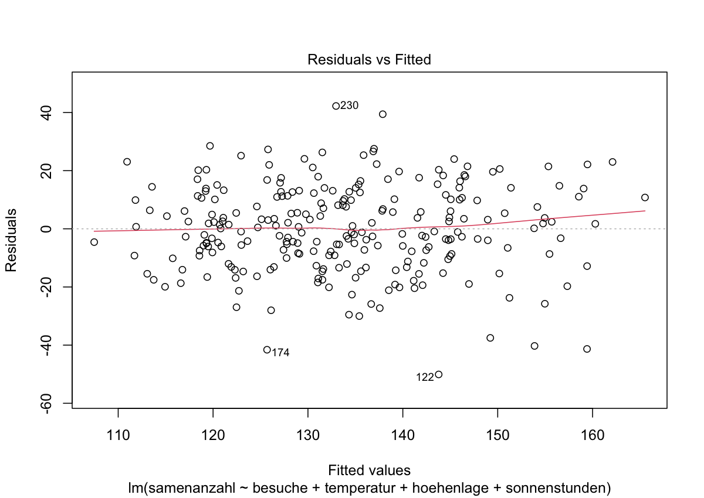
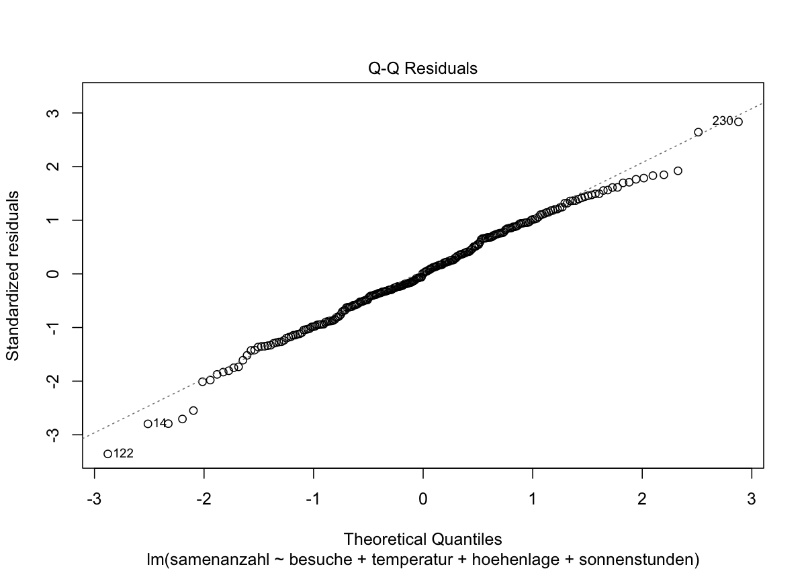

# EcoBee – Alpine Bestäubungs- und Ertragsprognose

**Semesterprojekt SMS HS26 – Zeno Egli & Djordje Djenadic**

## 1. Unsere Idee

EcoBee ist eine mobile App zur Überwachung der Bestäubung alpiner Pflanzen. Durch den Klimawandel und den Rückgang von Bestäubern sind viele alpine Ökosysteme gefährdet.
Oft ist unklar, wie sich Bestäuberbesuche und Umweltbedingungen auf die Samenproduktion auswirken.

Die App soll Bestäuberbesuche und Umweltdaten erfassen und mithilfe einer multiplen linearen Regression die Samenproduktion vorhersagen.
So könnten gefährdete Pflanzenbestände frühzeitig erkannt und gezielte Schutzmassnahmen geplant werden.

## 2. Datensimulation

Als Beispielpflanze verwenden wir den Kalk-Glocken-Enzian (*Gentiana clusii*). Für die Simulation haben wir in R einen Datensatz mit **250 Pflanzen** erstellt.

Jede Zeile steht für eine Pflanze an einem Messstandort. Der Datensatz enthält sechs Variablen:

| Variable | Beschreibung |
|---|---|
| pflanzen_id | Pflanzen-ID (1–250) |
| samenanzahl | Durchschnittliche Samenanzahl pro Blüte |
| besuche | Bestäuberbesuche pro Blüte und Tag |
| temperatur | Durchschnittliche Temperatur in °C |
| hoehenlage | Höhenlage in Metern über Meer |
| sonnenstunden | Sonnenstunden pro Tag |

### Simulationsparameter

- Höhenlage: 1200–2400 m
- Temperatur: Abhängig von der Höhenlage, mit zufälliger Streuung
- Sonnenstunden: 4–10 Stunden pro Tag
- Bestäuberbesuche: Poisson-Verteilung mit Mittelwert 6
- Samenproduktion: Angenommene Effekte von +5 Samen pro Besuch, +1,5 pro °C, −0,5 pro 100 Höhenmeter und +2 pro Sonnenstunde
- Zufälliger Fehlerterm: Normalverteilung mit Standardabweichung 15

Die Werte sind vereinfachte Annahmen, die wir für eine nachvollziehbare Simulation gewählt haben. Sie beruhen nicht auf eigenen Messungen. Mit `set.seed(2000)` ist die Simulation reproduzierbar.

## 3. Regression und Ergebnisse

Wir verwenden eine **multiple lineare Regression**, da wir die durchschnittliche Samenanzahl anhand von vier Prädiktoren vorhersagen möchten.

Das Modell wurde in R mit `lm()` berechnet.

| Prädiktor | Koeffizient | p-Wert |
|---|---:|---:|
| Bestäuberbesuche | +4,363 | < 0,001 |
| Temperatur | +1,572 | 0,0140 |
| Höhenlage | −0,00160 | 0,7011 |
| Sonnenstunden | +1,665 | 0,0025 |

**R² = 0,3936**

Das Modell erklärt rund 39,4 % der Streuung der simulierten Samenanzahl. Bestäuberbesuche, Temperatur und Sonnenstunden zeigen signifikante positive Zusammenhänge. Die Höhenlage ist nicht signifikant.

Die Ergebnisse zeigen, wie EcoBee zukünftig die Samenproduktion vorhersagen könnte. Da wir mit simulierten Daten arbeiten, müssen die Zusammenhänge vor einer echten Anwendung überprüft werden.

### Modellüberprüfung

Die Residuen zeigen keine auffälligen systematischen Muster und sind annähernd normalverteilt. Die Modellannahmen erscheinen für unsere Simulation angemessen.

### Projektdateien

- [R-Skript](EcoBee_Simulation.R)
- [Simulierter Datensatz](ergebnisse/ecobee_daten.csv)
- [Regressionsausgabe](ergebnisse/regression_ergebnisse.txt)
- [Projektbeschreibung – Aufgabe 4](projektbeschreibung.md)

## 4. Feedback und Zusammenarbeit

**Fragen an Tugce:**
1. Wie könnten wir einen sinnvollen Schwellenwert für eine zu geringe Samenproduktion festlegen?
2. Wie können wir beurteilen, ob unsere selbst gewählten Simulationsparameter realistisch genug sind, um daraus später ein brauchbares Modell zu entwickeln?

**Herausforderung:**
Die Auswahl realistischer Simulationsparameter ohne vollständige Messdaten. Unser Modell berücksichtigt ausserdem nicht alle biologischen Einflussfaktoren.

**Aufgabenverteilung:**
- Zeno:
  - Einrichtung und Gestaltung der GitHub-Seite
  - Aufbereitung und Veröffentlichung der Ergebnisse
- Djordje:
  - Umsetzung und Anpassung der Datensimulation in RStudio
  - Durchführung der Regression und Erstellung der Diagramme
- Gemeinsame Arbeiten:
  - Entwicklung und Auswahl der EcoBee-Idee
  - Festlegung der Variablen und des Regressionsmodells
  - Besprechung und Überarbeitung der Projektinhalte

**Verfügbarkeiten für ein Online-Gespräch:**
- Montag 09.11.2026 08:00 - 18:00
- Dienstag 10.11.2026 08:00 - 18:00
- Mittwoch 11.11.2026 08:00 - 12:00

## 5. Einsatz von KI

Wir haben ChatGPT zur sprachlichen Überarbeitung unserer Projektbeschreibung, zur Unterstützung bei der Auswahl und Erklärung der Simulationsparameter, bei der Erstellung des R-Codes sowie bei der Interpretation der Ergebnisse verwendet.
Die Grobfassung der index Datei erfolgte auch durch ChatGPT.

Die Projektidee, Rohfassung der Projektbeschreibung und die untersuchten Variablen stammen von uns. Die Simulation und Regression haben wir in RStudio selbst ausgeführt und überprüft.
